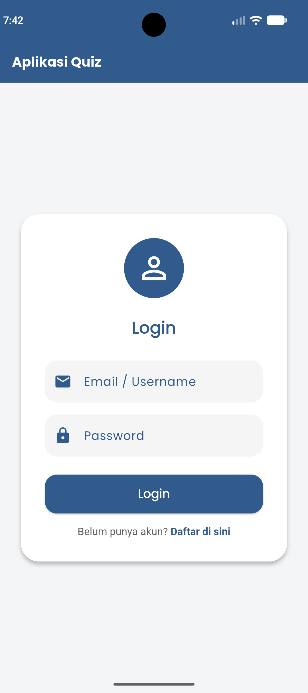
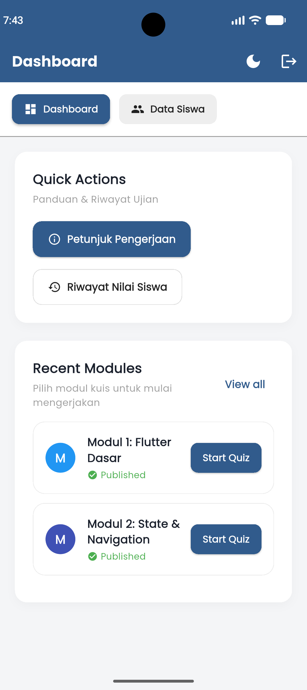
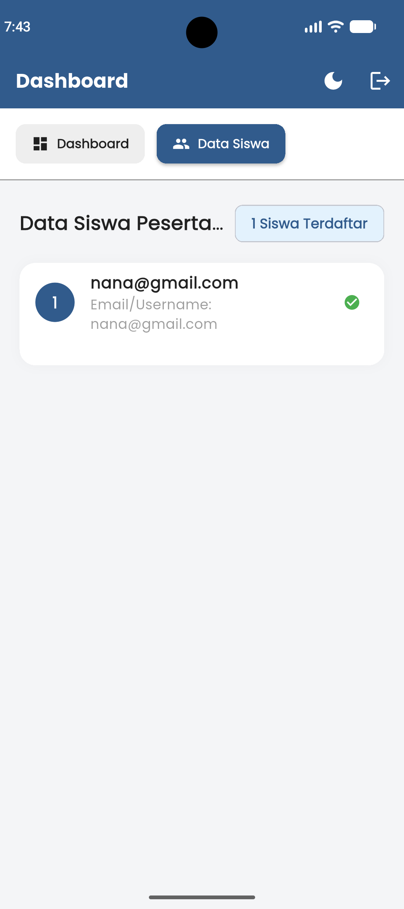
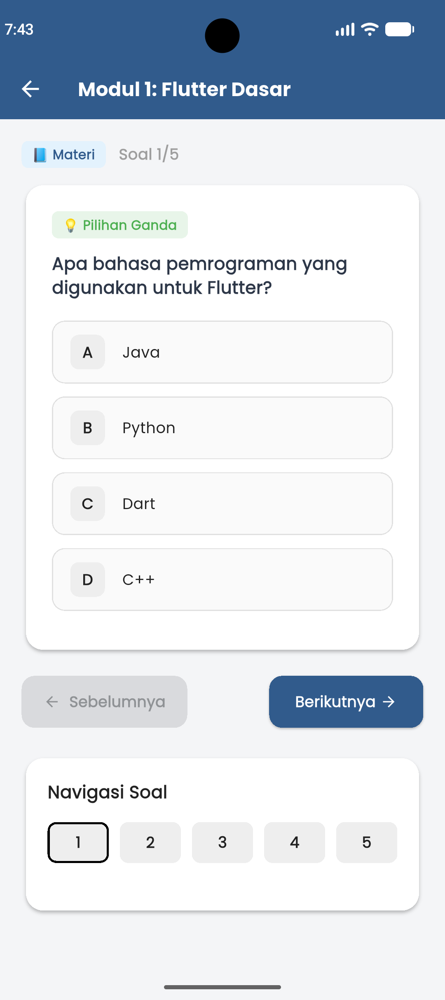
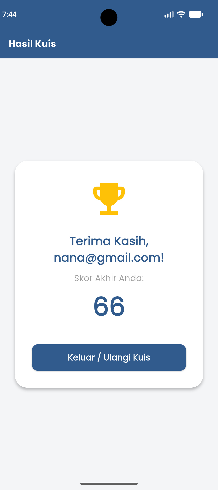
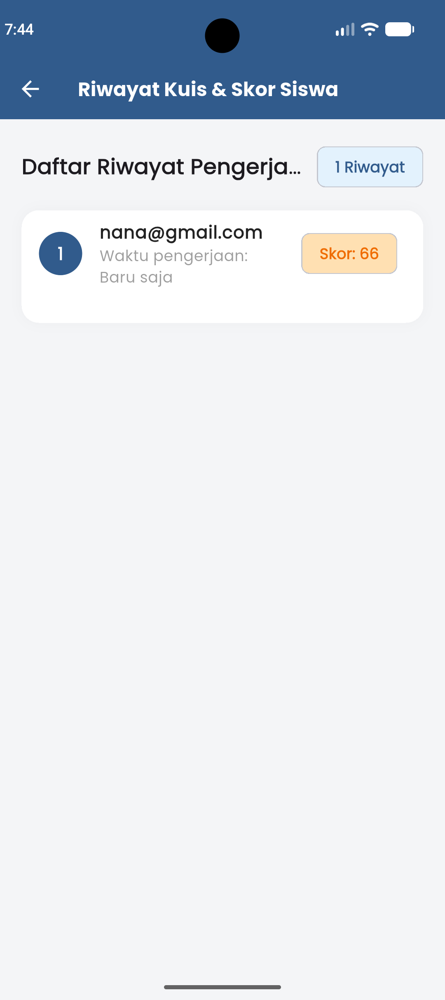

#  Aplikasi Quiz Pilgan (QuizPilgan)
Repositori ini dibuat untuk memenuhi tugas Ujian Tengah Semester (UTS) / Praktikum Pemrograman Mobile.

---

## a. Identitas Mahasiswa
- **Nama:** Nayla Syifa Tanjung
- **NIM:** 241401019
- **Lab:** 1

---

## b. Informasi Aplikasi
- **Nama Aplikasi:** QuizPilgan 
- **Deskripsi Singkat Aplikasi:** 
  QuizPilgan adalah aplikasi mobile berbasis Flutter yang dirancang untuk memudahkan pelaksanaan kuis dan ujian pilihan ganda secara interaktif. Aplikasi ini dilengkapi dengan sistem autentikasi (Login & Register), Dashboard interaktif dengan modul materi kuis, navigasi soal CBT, serta pencatatan riwayat nilai siswa secara *real-time*.
- **Fitur-fitur yang Tersedia:**
  1. **Autentikasi Pengguna:** Halaman Login & Register dengan validasi form dan fitur *auto-fill* kredensial saat selesai mendaftar.
  2. **Dual Theme (Light & Dark Mode):** Kemampuan beralih tema terang dan gelap secara instan di seluruh halaman aplikasi.
  3. **Dashboard Interaktif:** Menu navigasi (Dashboard & Data Siswa), panduan pengerjaan (*Quick Actions*), serta daftar modul kuis/ujian.
  4. **Modul Kuis Dinamis:** Tersedia berbagai modul pembelajaran dengan masing-masing soal pilihan ganda interaktif.
  5. **CBT Exam Screen:** Halaman pengerjaan soal dengan tombol navigasi (Sebelumnya, Berikutnya), grid navigasi soal, dan penghitungan skor otomatis.
  6. **Riwayat Nilai Siswa:** Halaman rekapitulasi riwayat pengerjaan kuis beserta skor yang diperoleh siswa.
  7. **State Management Lokal:** Menjaga progres jawaban dan navigasi soal agar tidak hilang saat rotasi layar atau navigasi antar halaman.

---

## c. Dokumentasi
- **Credit Sumber Aset:**
  - Ikon antarmuka menggunakan pustaka bawaan Flutter (`Material Icons` & `Cupertino Icons`).
  - Tipografi menggunakan font kustom **Poppins** melalui package `google_fonts`.
- **Screenshot Tiap Page Aplikasi:**
  *(Silakan lampirkan screenshot pada bagian ini)*
  - Halaman Login / Register
    
  - Halaman Dashboard
    
  - Halaman Data Siswa
    
  - Halaman Pengerjaan Kuis (CBT)
    
  - Halaman Hasil Kuis & Skor Akhir
    
  - Halaman Riwayat Nilai Siswa
    
- **Link Mockup / Prototype Aplikasi:**
  - https://www.figma.com/design/fzGbVXCbPvwMVU9jMOlAk6/KuisPilgan?node-id=0-1&t=g2uy9hoBvxKYdcGu-1
- **iv. Link Video Presentasi (Google Drive):**
  - [Link Video Presentasi Google Drive Anda di sini (Maksimal 10 menit)](https://drive.google.com/)

